# Hi, I'm João Bataglia

**Full Stack Developer** · Java · JavaScript/TypeScript  
📍 Ribeirão Preto, Brazil (UTC-3) · [LinkedIn](https://www.linkedin.com/in/joao-bataglia/) · [jpabataglia@gmail.com](mailto:jpabataglia@gmail.com)

## About me

I'm a developer at **davinTI**, where I work on Vitruvio, the company's Java/Spring/Vaadin BPM platform, and the products built on top of it. Most of my time goes into:

- **End-to-end integrations**: digital signature, ERP and receivables platforms, WhatsApp messaging, REST APIs and webhooks.
- **Performance and quality**: query and job optimization, unit tests and documentation.
- **AI products and tooling**: an AI product that reads supermarket shelf photos on serverless GPUs, and AI-assisted development for the team.
- **Developer experience**: Git-based delivery for the platform and a weekly study group with the company's developers.

## Tech stack

## GitHub stats

<picture>
  <source media="(prefers-color-scheme: dark)" srcset="./profile/stats-dark.svg">
  
</picture>
<picture>
  <source media="(prefers-color-scheme: dark)" srcset="./profile/top-langs-dark.svg">
  
</picture>
